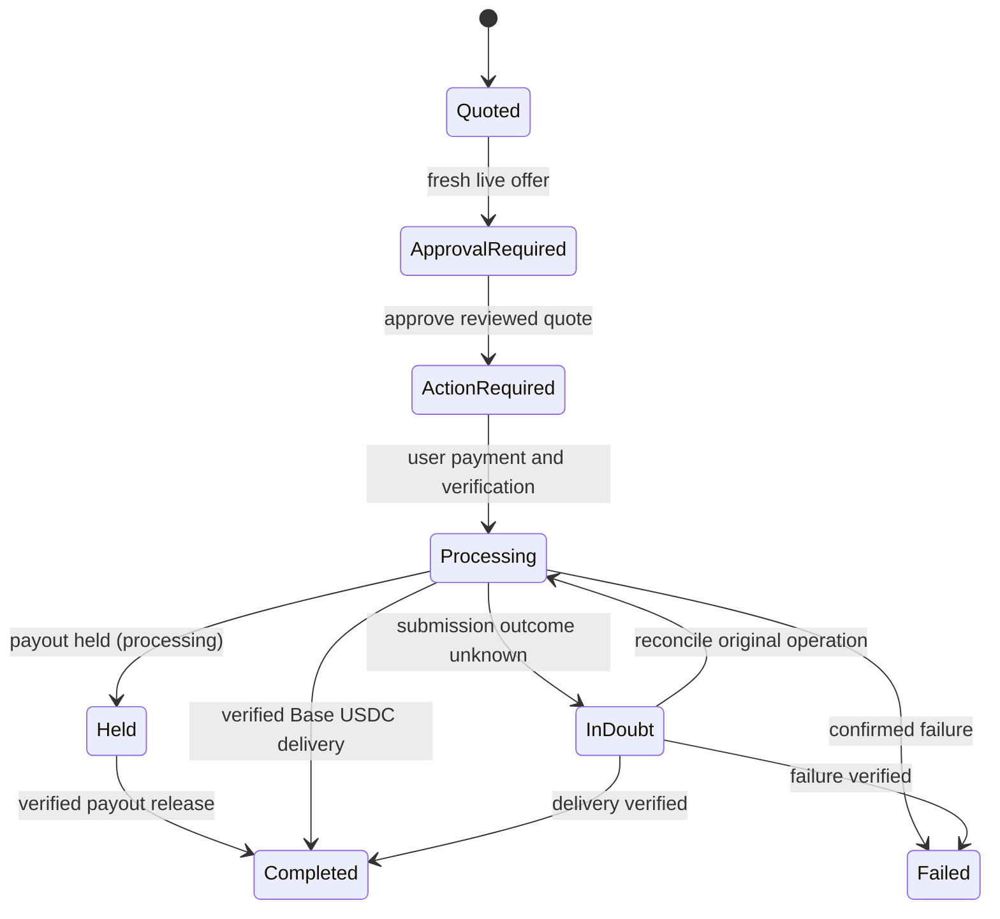
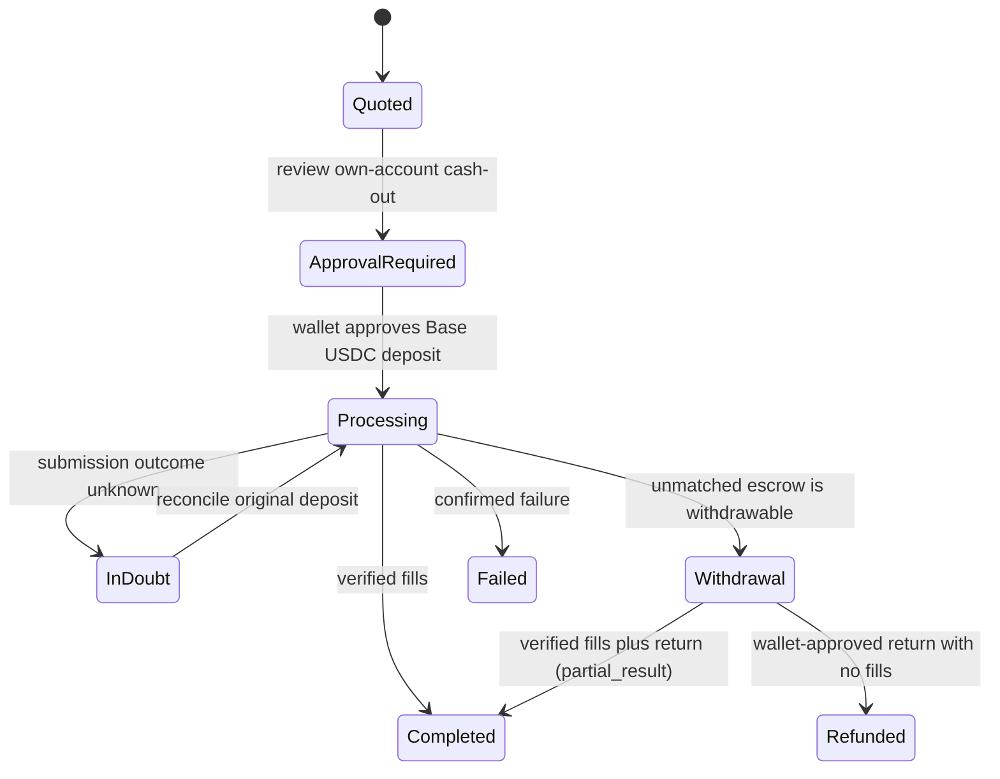
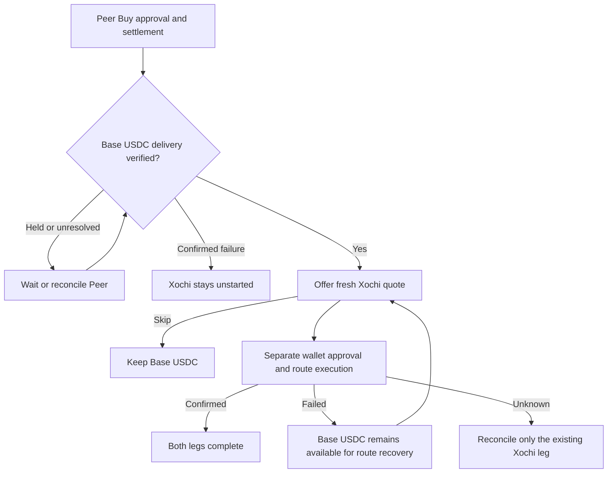
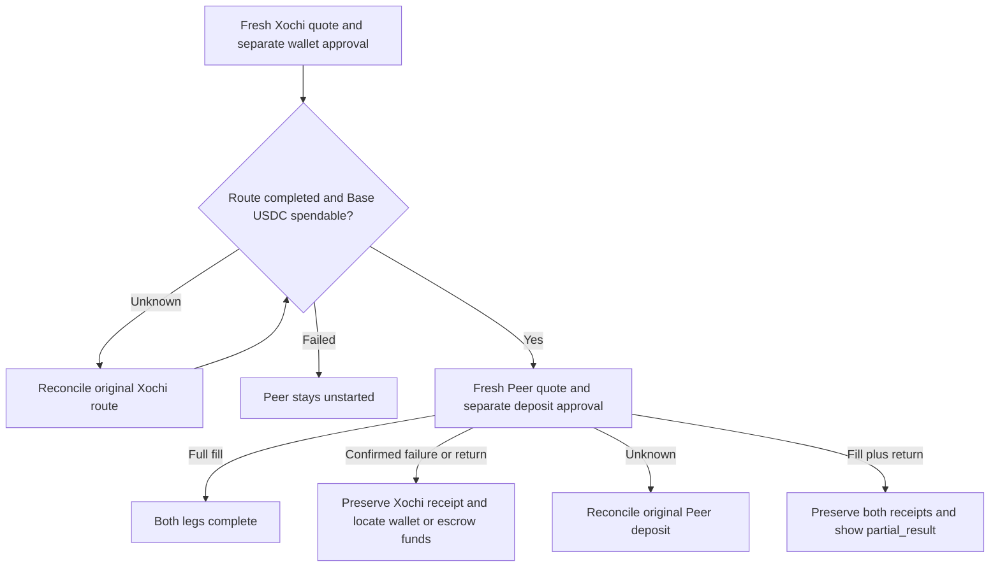

# ramp/1

Canonical public JSON wire contract for independently approved Peer and optional
Xochi ramp legs. Source availability is not package publication, hosted iframe
permission, live provider availability, or verified execution.

`contract.schema.json` defines the structural contract; `conformance.json` contains
synthetic, runtime-neutral inputs and expected semantic outcomes. Neither contains
live offers, provider credentials, or executable transactions. TypeScript bindings
are inferred from the runtime schemas and checked against the JSON Schema with the
same vectors. Regenerate the structural artifact with `npm run generate:ramp -w
@xochi/client`; CI fails when the committed schema differs from the generated one.
Raxol can consume these JSON artifacts directly; its Elixir binding and
cross-runtime execution remain cross-repository gates, not an SDK harness.

Schema `pattern` values use the ECMA-262 dialect that JSON Schema specifies, limited
to constructs RE2 also accepts (no lookaround or backreferences). `$` means end of
input, as in ECMA-262, RE2 and Rust. PCRE and Python treat `$` as also matching
before a final newline: compile with `dollar_endonly` (Erlang/Elixir) or use
`fullmatch` (Python). The trailing-newline vectors in `conformance.json` catch a
binding that gets this wrong.

## Messages

Every message has `contract_version: "ramp/1"` and a required `kind`:
`offer`, `intent`, `preview`, `snapshot`, `command`, or `error`. Every JSON field is
snake_case. TypeScript uses the same wire names; there is no second camelCase wire
schema. Unknown required discriminants fail closed. Caller-authored messages
(`intent`, `command`) reject unknown keys at every level, so a misspelt optional
field fails instead of being dropped. Provider data (`offer`, `preview`,
`snapshot`, `error`) discards bounded unknown fields and never forwards them.
`parseRamp(unknown)` is the public boundary:
it snapshots bounded own data descriptors before structural and semantic checks,
rejects accessors without invoking them (including discarded fields), and returns
sanitized data or only `invalid_request` / `unsupported_version`. Reflection failures,
including revoked Proxies, return `invalid_request`; escaped errors are neither
logged nor retained. The individual schemas describe shapes; do not substitute
shape validation for `parseRamp`.

Amounts are unsigned base-10 **atomic unit strings**, matching
`/^(0|[1-9][0-9]*)$/` over the entire string (including rejecting trailing newlines).
`atomic(string | bigint)` returns an exact branded string. Numbers, signs,
decimals, exponents, whitespace and leading zeroes are rejected. Fiat currency
and decimals, and crypto chain/contract/decimals, must be validated against live
provider configuration. A symbol is never asset identity. Phase 1 settlement is
Base USDC; the contract itself is provider-neutral vocabulary, not a capability
allowlist. Bounds must use their stated asset and satisfy minimum <= maximum.

Cross-field rules, checked by `parseRamp` after the shape:

- A CAIP-19 `asset_id` (`eip155:<chain>/erc20:<address>`) must name the asset's own
  `chain_id`. Asset identity is chain plus address; address case and the CAIP
  prefix are notation.
- Intent: `exact.money` uses the asset of its `side`. With a `route`, the Peer-side
  asset must be `crypto` (`route.from` on onramp, `route.to` on offramp) and
  `route.recipient` must equal `recipient`.
- Preview: one of `pay`/`receive` is fiat and the other crypto; a two-leg
  `leg_order` fixes the direction (Peer first pays fiat, Xochi first pays crypto);
  every fee is in the pay or receive asset.
- Command: `approve` and `execute_route` must carry `quote_id`.

Availability states: `available` (with `valid_until`), `setup_required`
(`requirement_codes`), `temporarily_unavailable` (`reason_code`, optional
`retry_after`), `not_supported`, and `availability_unknown` (`reason_code`).
An offer's expiry must follow its observation. Parsing a structurally available
offer **does not authorize execution**: discovery/preview must independently
establish a fresh live response, exact corridor/bounds/region/rail, Base USDC
identity, and current requirements. Static metadata and stale responses cannot
enable a rail. Full discovery normalization belongs to #169.

## Independent leg semantics

Snapshots contain mandatory `peer`, optional `xochi`, explicit `leg_order`, a
canonical unsigned integer-string `revision`, and a checked derived `terminal`.
Onramp ordering is Peer then optional Xochi; offramp ordering is optional Xochi
then Peer. Peer-only ordering is `["peer"]`.

Each leg has its own state, `recoverable` flag, optional bounded failure code and
public transaction hash. States: `not_started`, `quoted`, `approval_required`,
`action_required`, `processing`, `completed`, `failed`, `in_doubt`, `refunded`,
`skipped`. `rampOutcome()` derives overall state and never mutates a successful
leg. Terminal requires every requested leg to have ended and no failed leg to
remain recoverable. Failed and partial-success outcomes remain visible while
recovery is available; they are not relabelled pending. Completed Peer / failed
Xochi and completed prerequisite Xochi / failed Peer are partial success, not
atomic rollback. A skipped optional route does not erase Peer completion.
In-doubt is nonterminal and allows only `check_status`, never approve, execute,
requote, skip, or execute-again. Provider-specific reconciliation can be added
only through a reviewed contract change; recovery codes do not grant resubmission.

Commands carry `operation_id`, target `leg`, bounded `action`, and
`context: { expected_revision, idempotency_key }`, plus optional quote/disclosure
bindings; `approve` and `execute_route` require `quote_id`. `checkRampCommand` is a
pure preflight, **not an executor or durable idempotency store**. It returns
`invalid_command` for a command that fails the contract and `invalid_receipt` for
a malformed retained receipt instead of throwing. An exact command replay with its
retained receipt is recognized before stale revision checking; reuse of a key for
different content, wrong operation, or stale revision conflicts. New actions require current
revision, an existing leg, and an allowed action. A recoverable failed leg accepts
only its own `recover_peer` or `recover_route` action, or `check_status`; it cannot
execute again through ordinary approval/execution actions. Recovery actions cannot
restart processing, completed, refunded or skipped legs, regardless of their
`recoverable` flag; in-doubt anywhere still permits status only.
Retain idempotency receipts for the operation lifetime; after uncertain submission,
reconcile rather than invent another key or operation. Replays return the stored
receipt snapshot; revision conflicts return the latest sanitized snapshot.
The operation engine below owns persisted orchestration, transitions, atomic
command reservation and execution. Every signature and transaction approval remains caller-owned.

## Secret boundary

Only locally minted, non-authorizing references belong in public identifier
fields. Never copy provider session/order handles into them. Public requests,
fixtures, snapshots, examples, widget events, logs and telemetry must exclude
Peer cookies/OAuth codes, payment credentials/handles, identity documents or
attributes, proof material/session IDs, bearer URLs/recovery tokens, raw provider
responses/errors, wallet private keys/signatures, and Xochi read tokens. A string
matching a reference regex does not make a provider secret public. Caller and
adapter ownership of this boundary is mandatory; these schemas are not a
credential classifier. Never log input or schema diagnostics from an untrusted
provider. Public errors contain bounded codes, not raw provider messages.

The contract contains no wallet signer, browser dependency, provider transport,
new bridge, or hosted implementation. Peer adapters belong in `@xochi/widget`;
the existing iframe/wallet bridge remains in `@xochi/widget-lib`.

## Operation engine

`createRampClient({ peer, xochi?, store })` drives the contract with a trusted
`RampProvider` and optional independently approved `XochiRampLeg`. The API retains
the canonical snake_case command context (`expected_revision`, `idempotency_key`).
`get()` reads an immutable local snapshot; `recover(..., "check_status", context)`
explicitly reconciles it. Reads never submit or poll automatically.

Use `createMemoryRampOperationStore()` for a single runtime, or
`createBrowserRampOperationStore({ storage: localStorage, locks: navigator.locks })`
for browser persistence. Web Locks are mandatory for atomic reservation across
clients and tabs; do not implement this with an unlocked localStorage read/write.
Custom stores must serialize each operation's synchronous transaction callback and
commit it durably before returning. Do not clear receipts during an operation's
lifetime. Storage failures prevent provider submission; a failure to commit a
provider result leaves the durable reservation available for status reconciliation.

Before each external command the engine commits an incremented revision with an
`in_doubt` reservation and a receipt. Completion commits another revision. Exact
replays return their historical receipt, including after reload; changed key content
or stale revisions return the current snapshot without applying. Keys and command
content are retained only as SHA-256 digests, with the locally minted quote
reference when needed for execution replay. Receipts contain sanitized snapshots,
never the intent, recipient, preview, disclosures accepted by a particular user,
provider payload, or private handle. References supplied by adapters must be locally
minted and non-authorizing; schema validation cannot identify a secret disguised as
a reference.

Provider errors, deadlines (60 seconds by default; configurable with
`commandTimeoutMs`), aborted submitted interactions, malformed results, and unsafe
state regressions leave the affected leg `in_doubt` with status reconciliation
only. Late provider promises cannot update the store. A crash between reservation
and submission is also conservatively reconciled. Adapters must reconcile their
existing operation reference and must not treat a missing response as permission
to submit again. A live capability or quote expiry detected before submission
instead invalidates that unsubmitted leg. Completed legs survive the other leg's
failure, and dependent legs cannot start after a failed prerequisite.

The injected adapter instance remains pinned for the client lifetime. On resume,
provide the same provider implementation with its private operation lookup restored
through its own trusted runtime dependencies. Browser summaries deliberately cannot
restore provider-private state. Quotes and intents stay in memory: an unsubmitted
preview lost on reload needs a fresh preview; a submitted operation can still be
reconciled without that preview. Route approval/execution and recovery belong to
the optional route adapter, which owns fresh independent route quotes and explicit
wallet approvals. Its `quoteId()` returns the non-authorizing reference for an
approved route; `execute()` receives that reference to prevent quote substitution.
The engine never supplies a wallet signer or provider launch URL.

Peer leg snapshots may include optional `payout_state: "held" | "released"`. A held payout remains `processing` and is nonterminal; it is not confirmed Base USDC. `released` requires verified payment to the recipient, not merely a closed StakeVault lock (which can also close after a dispute). Older snapshots omit this field. Consumers, including Raxol, must accept the additive field.

A terminal Peer maker cash-out that both fills and returns funds uses
`peer.state: "completed"` with optional `peer.partial_result`:
`{ settlement: "base_usdc", filled_atomic, returned_atomic }`. Both totals are
positive canonical atomic strings bounded to 31 digits; unknown fields are
rejected. Filled is gross Base USDC debited by verified fills, including fees,
not a fiat receipt amount. A mixed result is `partial_success`, never a wholly
refunded leg; it permits no resubmission. Pure completion and pure return retain
their existing shapes. Public readers should preserve this additive ramp/1 field
to explain the split after reload.

## State diagrams

These diagrams show the user-visible execution and recovery paths. Use the
snapshot's `allowed_actions` to decide which action is available at a given
revision.

### Peer onramp

### Peer offramp

### Buy then Xochi route

### Xochi route then cash-out

Available offers expire. Refresh the exact corridor and amount before approval,
and reapprove any replacement quote. Each composition is non-atomic. Persist
and recover each leg independently, and derive the overall outcome with
`rampOutcome`.
